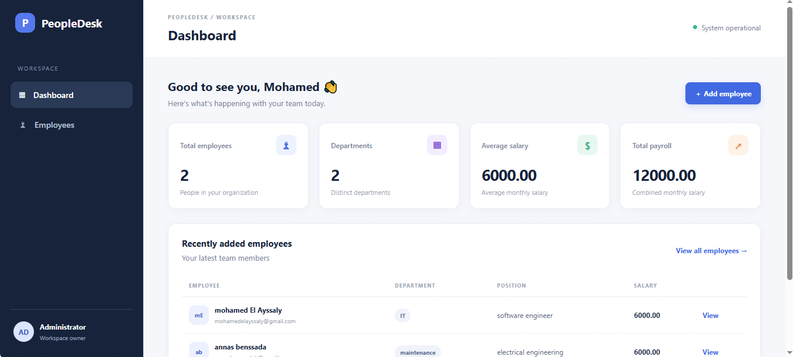

# PeopleDesk — Employee Management System

A portfolio-ready employee management web application built with Python, Flask, Flask-SQLAlchemy, SQLite, HTML and CSS.

## Features
- Dashboard statistics: employee count, departments, average salary and payroll
- Employee CRUD: create, read, update and delete
- Search by name, email, department or employee ID
- Department filtering
- Input validation and duplicate-email handling
- Responsive custom CSS interface
- Automated tests with pytest

## Requirements
- Python 3.10+
- pip

## Setup (Windows PowerShell)

```powershell
# 1. Create and activate a virtual environment
py -m venv .venv
.venv\Scripts\Activate.ps1

# 2. Install dependencies
python -m pip install -r requirements.txt

# 3. Run the application
python run.py
```

Open http://127.0.0.1:5000 in your browser.

The SQLite database is created automatically in `instance/employees.db` the first time the app starts.

## Run tests

```powershell
python -m pytest -v
```

## Architecture
- `app/models`: database models (Employee class)
- `app/routes`: Flask routes and HTTP request handling
- `app/services`: business logic, separated from routes
- `app/templates`: Jinja2 HTML templates
- `app/static`: CSS styling
- `tests`: automated tests

## Learning challenges
1. Add pagination to the employee list.
2. Add a department summary and salary sorting.
3. Add CSV export.
4. Add login/logout with password hashing and role-based access.
5. Add a REST API for employee CRUD.
6. Add database migrations with Flask-Migrate.
7. Add structured logging and improve test coverage.

## Security note
This is a learning project, not a production-ready HR system. Before deploying it, add authentication, CSRF protection, secure configuration, authorization, migrations, and stronger validation.


## Screenshots


